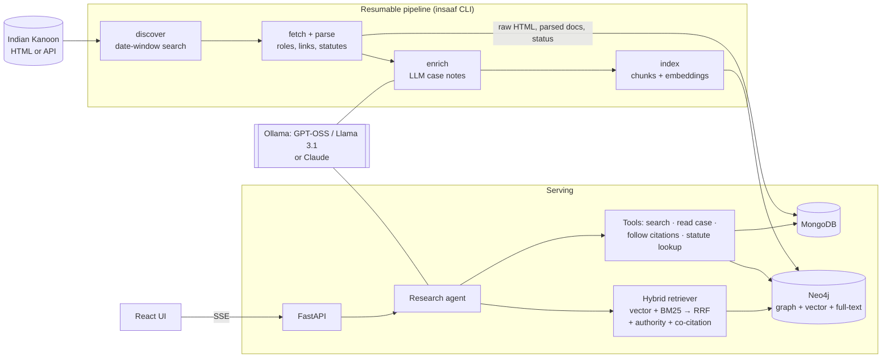

# Insaaf AI v2: agentic GraphRAG over Indian case law

> Justice, researched. Ask a legal question; Insaaf searches thousands of judgments, follows the citation graph, and answers with sources it can show it actually retrieved.

Insaaf ingests judgments from Indian Kanoon (Bombay High Court by default), turns them into a **knowledge graph** of cases, judges, parties, statutes and citations in Neo4j, and serves a **retrieval-first research agent** over it through a FastAPI backend and a React frontend.



## What changed from v1

| | v1 | v2 |
|---|---|---|
| Scraping | Selenium clicking “PDF” with a 15 s sleep per doc | Async HTTP, global rate limit, robots.txt, retries/backoff, resumable queue; official API used when a token is set |
| Coverage | One search listing per year (page-capped) | Date windows split recursively until each fits under the page cap |
| Text | PDF → text, truncated at 6,000 chars | Structured HTML: Indian Kanoon's rhetorical roles (Facts / Issue / Precedent / Conclusion…) kept per paragraph; noise stripped |
| Knowledge graph | LLM invented free-form node ids; the uploader read the wrong keys (`label`/`start`/`end`), so every node became `:Unknown` and no edges were created | Deterministic graph from markup: `CITES` from real hyperlinks, normalised statute keys (`IPC::302`), judges, parties, courts; the LLM adds only case notes |
| Retrieval | n8n workflow | Hybrid dense + full-text with RRF fusion, authority prior, co-cited-precedent expansion, all in Neo4j |
| Answers | Uncited chat | Every `[doc:ID]` is checked against what the agent retrieved; unverified citations are flagged in the UI |
| Ops | Hardcoded credentials, Windows paths | `.env` config, Docker Compose, health checks, request IDs, structured logs, API keys, 68 tests |

## Quick start (local)

Requirements: Python 3.11+, Node 20+, [Ollama](https://ollama.com), and MongoDB + Neo4j 5.13+ (via Docker or native installs).

```bash
cp .env.example .env                       # set NEO4J_PASSWORD
make setup                                 # venv + npm install
ollama pull gpt-oss:20b && ollama pull llama3.1:8b && ollama pull nomic-embed-text
docker compose up -d mongo neo4j           # or run them natively

cd backend
.venv/bin/insaaf init-db                   # Mongo indexes + Neo4j constraints / vector & full-text indexes
.venv/bin/insaaf run --court bombay --from 2023 --to 2023 --limit 50   # small end-to-end batch
.venv/bin/insaaf ask "When has the Bombay High Court granted bail because of delay in trial?"

make api     # http://localhost:8000/docs
make web     # http://localhost:5173
```

## Ingestion pipeline

Each stage reads its input from MongoDB by `status`, so stages can be stopped, resumed, scheduled (cron or n8n) and scaled independently.

```bash
insaaf discover --court bombay --from 2015 --to 2024 [--query "bail"]   # queue doc ids
insaaf fetch   --limit 1000          # download + parse (+ resolve linked statute pages)
insaaf enrich  --limit 1000          # LLM case notes: summary, issues, holding, outcome, principles
insaaf index   --limit 1000          # chunk → embed → write graph
insaaf stats                         # pipeline + graph counts
insaaf reparse                       # re-apply an improved parser to stored HTML, no network
```

Notes on scale:
- One week of Bombay HC on Indian Kanoon is ~7,000 documents, orders included. Discovery splits date windows automatically and logs `discover.truncated` when a single day still overflows the page cap; add `--query` to narrow it.
- At the default 0.5 req/s, 23k judgments take about 13 hours to fetch. For bulk ingestion use the [official Indian Kanoon API](https://api.indiankanoon.org) (`KANOON_API_TOKEN`), and respect the site's terms of use.
- `fetch --no-resolve-statutes` skips statute-page lookups. Statutes are still extracted from the judgment text by regex (IPC, CrPC, BNS/BNSS/BSA, NDPS, POCSO, NI Act, Constitution and ~25 more).

## Graph model

```
(:Judge)-[:ON_BENCH|AUTHORED]->(:Case)-[:DECIDED_IN]->(:Court)
(:Party)-[:PARTY_TO {role}]->(:Case)
(:Case)-[:CITES {mentions}]->(:Case)
(:Case)-[:REFERENCES {mentions}]->(:Section)-[:OF_ACT]->(:Act)
(:Case)-[:HAS_CHUNK]->(:Chunk {text, roles, embedding})   # vector + full-text indexed
```

Try in Neo4j Browser (http://localhost:7474):

```cypher
// leading precedents on Section 302 IPC in the corpus
MATCH (:Section {id:'IPC::302'})<-[:REFERENCES]-(c:Case)-[:CITES]->(p:Case)
RETURN p.title, count(*) AS cited ORDER BY cited DESC LIMIT 10
```

## API

| Method | Path | |
|---|---|---|
| POST | `/api/chat` | `{messages:[{role,content}], stream?: true, mode?: "agent"\|"rag"}` returns SSE events `status`, `tool_call`, `tool_result`, `token`, `citations`, `done`, `error`; with `stream:false`, returns JSON (useful for n8n/webhooks) |
| GET | `/api/search?q=&court=&year_from=&year_to=&limit=` | hybrid case search |
| GET | `/api/cases/{id}` | judgment paragraphs with roles, case note, provisions, citation neighbourhood |
| GET | `/api/stats` | pipeline and graph counts |
| GET | `/api/health` | Mongo + Neo4j checks (public) |

Set `API_KEYS=["…"]` to require an `X-API-Key` header.

## Models

| Role | Default (local, free) | Hosted alternative |
|---|---|---|
| Research agent | `gpt-oss:20b` via Ollama | `claude-opus-5-5` (`CHAT_PROVIDER=anthropic`) |
| Case-note extraction | `llama3.1:8b` | `claude-haiku-5-5` |
| Embeddings | `nomic-embed-text` (768-d) | any OpenAI-compatible embeddings endpoint |

`AGENT_MODE=rag` skips tool calling (one retrieval, then a streamed answer). Use it for small models that call tools unreliably.

## Project layout

```
backend/src/insaaf/
  scraper/      polite HTTP client, Indian Kanoon source, HTML parser
  processing/   statute normaliser, paragraph-aware chunker, LLM enrichment
  storage/      MongoRepo (system of record), GraphStore (Neo4j graph + indexes)
  retrieval/    hybrid search, RRF, authority prior, co-citation expansion
  agent/        tools, source registry / citation verification, agent loop
  llm/          provider-neutral interface; OpenAI-compatible + Anthropic
  api/          FastAPI app
  pipeline.py   resumable stages        cli.py   `insaaf` command
frontend/src/   chat with live research trace + sources panel, search, case viewer
```

## Testing

```bash
make test     # 68 backend tests (no services needed: LLM/Neo4j/Mongo are faked) + TS type-check
make lint
```

---

*Insaaf provides legal research assistance, not legal advice.*
